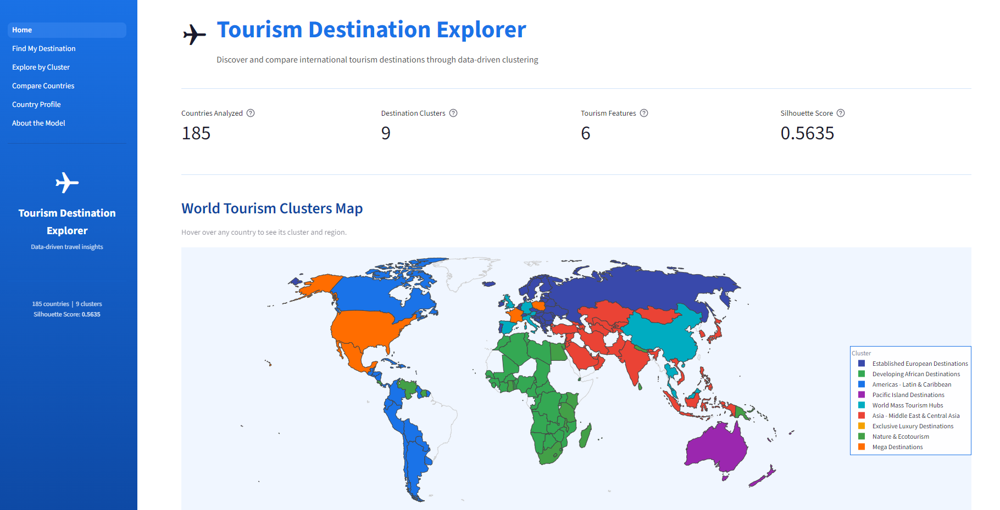

# Tourism Destination Clustering

```text
> Machine Learning / Unsupervised Learning
> Application: Streamlit
> Status: Deployed
```

<p align="left">
  <a href="https://tourism-destination-clustering.streamlit.app/">
    
  </a>
</p>




## Features

1. Destination Discovery
2. Tourism Cluster Exploration
3. Country Comparison
4. Country Profiles
5. Clustering Model Overview

## Tech Stack

Python · Streamlit · Pandas · NumPy · Scikit-learn · KModes · Plotly

## Getting Started

```bash
git clone https://github.com/YOUR_USERNAME/tourism-destination-clustering.git
cd tourism-destination-clustering
pip install -r requirements.txt
streamlit run Home.py
```

## Academic Project

Developed as part of the Informatics program at Universitas Trunojoyo Madura.
